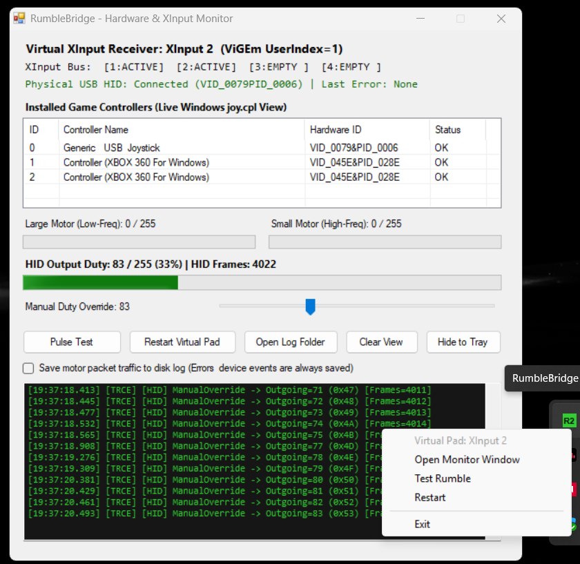

# RumbleBridge

**XInput-to-USB-HID vibration bridge for generic DragonRise (`VID_0079&PID_0006`) controllers on Windows.**

Built to get controller rumble working in the **Steam version of Forza Horizon 4** (and any other modern PC game) using a cheap generic DirectInput controller whose rumble motor ignores standard Windows vibration commands. For somereason my specific controller didn't work with any drivers or workarounds.

## Prerequests
 - [ViGEmBus Driver](https://github.com/nefarius/ViGEmBus/releases)
 - [x360ce (4.x)](https://www.x360ce.com/)
 - A generic USB controller matching VID_0079&PID_0006 (DragonRise Inc. Generic USB Joystick). (If your pad uses a different VID/PID or HID command sequence, you can adjust the filter string and byte array in the source code.) Just give the whole source code to AI.
 - you may or may not need to install a generic controller driver to expose the existence of "rumble" to games or apps. do it if nothing helps your case. [driver](https://github.com/alessandroasm/generic-usb-gamepad-vibration-driver) 

---

## Why This Exists

1. My controller for somereason did not work with nothing. no apps no drivers no tests.
2. **DragonRise (`VID_0079&PID_0006`) firmware ignores standard HID rumble packets.** Even if you use `x360ce` to map your buttons to a virtual Xbox 360 controller, the physical motor won't spin unless you send a specific 2-packet vendor handshake (`0x51` unlock command followed by `0xFA 0xFE` motor speed) directly to the raw USB HID interface.

    **RumbleBridge** solves this by spawning a lightweight virtual Xbox 360 controller via ViGEmBus purely to catch XInput vibration packets, translating them into the raw 9-byte USB HID sequence your physical controller actually understands.

3. It allows you to see what the game is sending as rumble data



---

## How the Signal Chain Works

```text
Game (Forza Horizon 4 / Steam)
   │  (Sends XInput vibration to Slot 1)
   ▼
x360ce Virtual Pad [XInput 1]  ──► Handles all your buttons & sticks
   │  (Force Feedback Pass-Through to Slot 2)
   ▼
RumbleBridge Virtual Pad [XInput 2]
   │  (Translates XInput motor values into 0x51 + 0xFA 0xFE HID reports)
   ▼
Physical Generic USB Joystick (VID_0079&PID_0006) ──► Motor spins
```

## HOW TO USE
Run the PowerShell build script to automatically download Nefarius.ViGEm.Client.dll and compile RumbleBridge.exe using Windows' built-in .NET Framework 4 compiler (csc.exe).

Installed executable will be at %USERPROFILE%\RumbleBridge

Installation requires internet access because it will download [https://www.nuget.org/api/v2/package/Nefarius.ViGEm.Client/1.21.256](https://www.nuget.org/api/v2/package/Nefarius.ViGEm.Client/1.21.256)

 - Disable Steam Input override
 - Open x360ce first so its virtual Xbox 360 controller claims XInput 1 (this handles all your buttons and sticks).
 - Open RumbleBridge.exe second so its virtual controller claims XInput 2
 - Check the green tray badge: it should display R2.
 - in x360ce window; open Force Feedback tab and Enable Pass-Through: `XInput2` then don't forget to click "Save All"

(Note: In x360ce's Issues tab, click Ignore on "Leftover Virtual Controllers" so it doesn't try to unplug RumbleBridge.)

